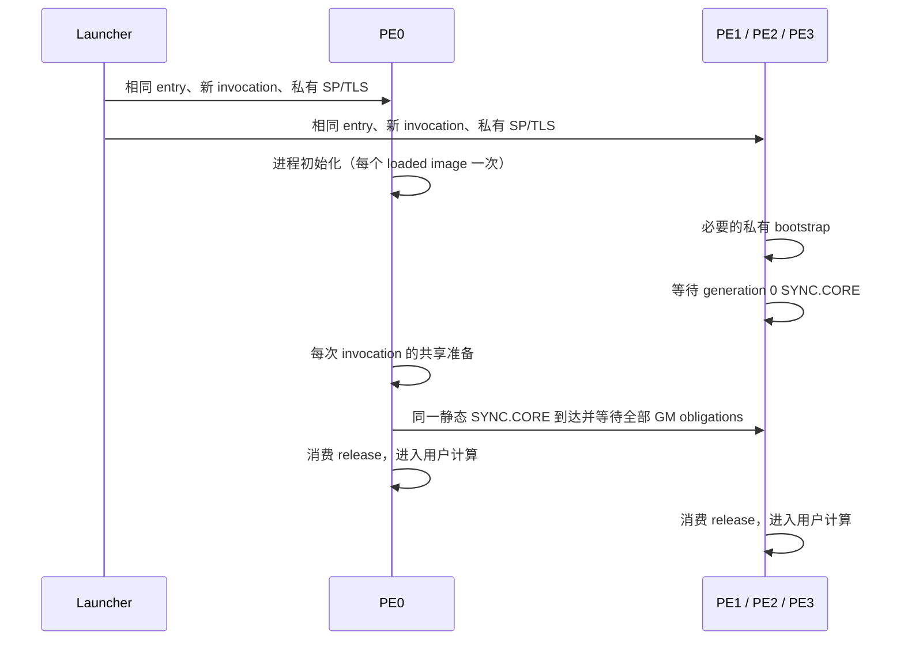

# 四 PE 启动、协作计算与退出

本文说明本地 `0.59` 的四 PE 软件调用链。规范依据为 [需求 #360](https://github.com/PTO-ISA/pto-spec/issues/360)、[SYNC.CORE PR #373](https://github.com/PTO-ISA/pto-spec/pull/373)、[启动 ABI PR #415](https://github.com/PTO-ISA/pto-spec/pull/415)。对齐时读取的远程 pto-spec main 为 `7573753b99d9e9ffa750a0adf637eec014056f1a`；最终语义由 `asl/scalar/sys/SYNC.CORE.asl`、`asl/arch/state/core-synchronization.asl`、`asl/arch/memory-model/gm-obligations.asl` 和 `asl/arch/state/kernel-lifecycle.asl` 的 ASL/NDF 定义。

## 1. 平台建立一次 invocation

一个 Core 同时只允许一个 active invocation。launcher 在旧 invocation 已结束且不可撤销请求已经静止后，创建新的身份，将 PE0、PE1、PE2、PE3 的 PC 设置到**同一个 runtime entry**。每个 PE 独立执行，以 `get_thread_idx()` / `__builtin_linx_get_thread_idx()` 读取自己的 ID；底层是 `THREAD_ID` 系统寄存器 `0x26`。

进入 C/C++ 前，平台必须给每个 PE 建立独立、有效的 SP、私有存储、TLS/TP 和启动参数。四个栈及 TLS 区域不能相互覆盖，也不能覆盖 PE0 正在初始化的数据。descriptor 以及其 `state[4]`、`result[4]`、`error` 必须由 launcher 分配、初始化并在启动前发布，生命周期覆盖所有在途请求及结束回调。只创建宿主线程、设置 PE mask 或执行 SYNC 都不会创建架构 PE 上下文。

目前共享 descriptor 的平台 ABI 是 `pto_runtime_group_context`：32 字节，magic=`0x50544f47`，version=1，participant_count=4，三个指针的偏移分别为 8、16、24。它不是 ISA 规定的数值 ABI，也不承载 invocation ID；平台在 descriptor 之外关联身份。descriptor、私有区和启动绑定在 invocation 期间不能被并发替换。

Linux 的 `pto_runtime_group_launch()` 接受单个 entry 和四组私有范围，检查范围溢出、重叠、SP 对齐、TP 所属范围；目标 ABI、映射、权限、TCB/DTV 格式、参数和共享区隔离由 backend 验证并建立。没有注册 launch backend 时返回 `-EOPNOTSUPP`。注册者必须保持回调及 descriptor 有效，直到 finish；active 时 unregister 返回 `-EBUSY`。这些是内核内部接口，**不是新增的用户态 syscall 或已实现的设备 launcher**。

## 2. 同入口与 PE0 初始化

运行流程如下：



compiler-rt 的 `__linx_group_worker_start()` 获取 descriptor，`__linx_group_entry()` 读取 PE ID 并校验 descriptor。只有 PE0 执行可选钩子：

```c
int __pto_runtime_process_initialize(void); /* 每个 loaded image 成功一次 */
int __pto_runtime_invocation_initialize(
    const struct pto_runtime_group_context *context); /* 每次 launch */
```

零返回表示成功。两者都不能调用四 PE collective，因为 workers 已在启动屏障等待。process hook 中途失败会使该 image 保持 poisoned，必须重新加载进程；invocation 准备失败可在平台完成 Abort 后重新启动，由准备代码修复已提交的部分数据。process 状态只有 PE0 访问，worker 不轮询 ready flag。

PE0 成功后与 workers 到达 worker runtime 内的同一静态 `SYNC.CORE`。这是本 invocation 的 generation zero。只有消费真实 release 后才能调用 `__linx_group_pe_main(pe, context)`。即便只让某个 PE 加载数据，也必须保留四个参与者的启动到达。

### 两种 CRT 路径

- **SSM.PTO v1 freestanding adapter**：`test/common/gfrun_runtime_adapter.c` 的 `_start` 直接进入 worker。默认 weak process hook 在 PE0 调用 `_init` 和 init array；应用可覆盖此钩子。它不运行完整 musl 进程初始化。构建使用 `-nostartfiles -mlinx-group-runtime`，由 compiler-rt archive 提供 worker。
- **musl 固定地址 static CRT**：四 PE 进入相同 `_start`，group descriptor 存在时转入 `__pto_musl_group_start`。PE0 初始化环境、libc 全局状态、TLS 布局元数据、stack guard 和构造函数；不重新绑定平台预先建立的 TP。随后进入同一个 worker，执行每次 invocation hook。worker 在启动 release 前不读取 PE0 记录的 argc/argv。普通单上下文进程仍走 `__libc_start_main`。

musl group 平台必须提供符合 musl 内部 TCB、DTV、TLS image、locale、canary 和宿主服务约定的四套私有状态；“非零 TP”不是充分条件。已有 Linx musl 原子操作仍有历史 stub，因此不能据此宣称 pthread、并发 libc 服务已验收。静态 PIE 的自重定位发生在 CRT shared 初始化之前，目前明确拒绝多 PE，worker 在 relocation 写入前 trap；需要专门 loader 后才能支持。动态加载器及 Linux 实际设备启动尚无四 PE 运行验收。

`-mlinx-runtime-intra-abi` 用于统一运行时库构建，显式断言其直接/间接调用遵守 IntraCore scalar GM ABI。它使构造函数指针和 libc 外部调用具有调用点合同；不能用它掩盖不匹配的库。默认编译仍拒绝无合同的外部或间接内存调用。

## 3. 协作加载与 Shared publication

启动屏障只发布启动前已经完成的共享准备。后续数据加载要使用对应 Tile 操作的参与集合、allocation mask、布局和 generation 生命周期。

- 普通 `TLOAD` 的 Local 输出属于对应 PE 的 Local Tile。各 PE 根据 ID 分配互不冲突的 GM 范围，再执行自己的加载、计算和存储。
- Shared 输出是 Core 私有的持久 descriptor/payload。多 PE 协作加载必须依照该操作支持的 mask 及分片规则；mask 表示操作参与，不能改变 `SYNC.CORE` 的四 PE 成员集合。
- 显式 range assembly 使用 `INIT/MIDDLE/LAST` 生命周期。writer 写入合法、不重叠的范围，最后的 `LAST` 原子发布完整 generation；尚未发布的 candidate 不能被消费者读取。
- 普通卷积权重转换 `TLOAD<OHWI2NK/OIHW2NK>` 默认单 bit mask，不带 assemble carrier 时不能仅把 mask 改成多 bit 来实现协作。
- cooperative matrix 输入必须满足完整 allocation/initialized mask `1111`、descriptor 已发布且 payload 定义完整的要求。

详见 [TLOAD](tlsu/load-store-move/TLOAD.md)、[B.SUBVIEW / B.ASSEMBLE](b-subview-b-assemble.md)、[Local 与 Shared](concepts/local-and-shared-tile.md)。`SYNC_CORE()` 不创建 Shared descriptor，也不能替代 LAST publication 或把部分初始化的 Shared 变成完整输入。

## 4. 计算阶段的同步

公开 `SYNC_CORE()` 使用 compiler builtin，生成严格的三个 32 位字：

```text
BSTART.SYS FALL  0x00001081
SYNC.CORE       0x0330a02b
BSTOP           0x00000001
```

不能在此 envelope 中插入其他 modifier 或 body 指令。LLVM 保留其 side effects、convergent、noduplicate 和内存边界属性，禁止将它当作普通纯函数删除、复制或跨越内存操作重排。

所有四个 PE 必须在同一 Core、同一 invocation、同一静态 site、相同动态顺序到达。例如按 PE ID 分配工作之后，分支要汇合到共同调用点：

```cpp
unsigned pe = get_thread_idx();
// 各 PE 完成本轮自己的分片；负载可以不同。
produce_partition(pe);
SYNC_CORE();                 // 四 PE 都执行同一个 site
consume_completed_partitions(pe);
SYNC_CORE();                 // 全部消费者完成后，才进入下一轮覆盖
```

上述是控制流程示意；`produce/consume` 的调用声明还须具有相匹配的 scalar shareability 合同。不要在 `if (pe == 0)` 内单独调用 SYNC，也不要让不同 PE 用不同循环次数到达屏障。

release 必须等待四个实际 arrival 和之前相关的 GM obligations，包含未发射的 TLSU、其生产者及已发射请求，提供跨参与者 RW→RW 顺序。volatile、编译器 memory clobber、本地 fence、ready flag、时间延迟都不能替代它。worker 中的 volatile state/result 只记录结果，跨 PE 的可见性依靠真实 SYNC。具体请求完成、保留 release、LR/SC reservation 失效与 interrupt/restart 由硬件/模型保证，软件轮询不能补出这些语义。

## 5. Shared 复用

Shared handle 不是普通 C++ 数值，不能通过非 inline ABI、对象存储、spill 或普通函数返回值跨阶段保存。短生命周期使用 `SharedTile` 和 `PTO_SHARED_INLINE`；跨控制流的生产者/消费者用显式 `SharedTileSlot<S, LocalTile>`，双方必须引用相同架构 slot，且不能与同时存活的另一个对象别名。

复用同一 slot 前，先确保上一轮所有消费者已经完成，再开始下一轮 generation。典型顺序为“生产并完成 publication → 消费 → 四 PE 同步/对应操作规定的完成边界 → 覆盖复用”。不能提前将旧 descriptor 解释为新 shape，也不能把 SYNC 当成 assembly LAST。双缓冲需要两个独立 slot 及各自的生产/消费生命周期。

End/Abort 会退休对应 invocation 的 pending candidate/release 元数据，但保留已发布 Shared parent、payload 和已提交效果。重新 launch 时应用必须明确决定保留还是重建数据；不能假定退出自动清零 Shared。关于 slot、布局兼容和 valid region 见 [Local 与 Shared](concepts/local-and-shared-tile.md)。

## 6. 正常退出与异常

每个 PE 的 callback 返回后，worker 写自己的 `result[pe]` 和 DONE/ABORT 状态，然后四 PE 在共同的 completion SYNC 汇合。PE0 汇总失败状态，设置 error，再调用平台的 `__pto_runtime_group_complete`；其余 PE park，等待平台退休整个 invocation。返回非零 callback 仍参加 completion 屏障，不允许提前绕过其他 PE 的同步。

SSM adapter 使用已存在的 SSM.PTO v1 `BSTART.SYS / ACRC 0 / BSTOP` completion service（tag `0x50544f01`），由模型执行正式 End/Abort。这个 service tag 不是通用 ISA exit ABI，也不是 Linux syscall。平台 hook 缺失会通过 SYS `EBREAK 0` 产生软件断点故障，不能把退出循环或 PC 停止当作正常 End。

Linux 新启动路径通过 `pto_runtime_group_finish(context, invocation, status)` 完成：先核对 active descriptor 和 invocation ID，拒绝过期完成；backend quiesce 全部 PE/GM 后，才调用 end/abort 并允许下一次 launch。旧 completion-only 接口不能退休新启动接口创建的 invocation。具体 trap transport、设备中断、用户错误报告和进程 finalizer 由平台实现。group invocation End 不等于进程退出，不在每次 invocation 重跑 atexit/析构。

初始化失败、用户 callback trap、不可恢复访存故障和缺失 PE 都不能伪造成功 release。缺失参与者保持 blocked，平台可请求 Abort。Abort 取消可逆工作，等待不可撤销旧请求静止，保留已提交 GM/Shared 效果。下次 launch 必须使用新 invocation 和新 generation-zero 屏障，旧到达、旧 release、迟到 completion 均不能进入新计算阶段。调用 `exit()` 退出整个 hosted 进程的行为属于平台政策；推荐 callback 返回状态交给 group runtime 汇总。

可恢复 trap/interrupt 在同一 invocation 按精确重启合同恢复，handler 不能作为 kernel 的另一个 arrival。恢复不应从 `_start` 重新运行构造函数，也不能重复登记已经提交的 arrival。此行为需要目标模型/硬件的中断和请求重启支持，runtime ELF 测试不替代相关 ISA 测试。

## 7. 验证与当前边界

四 PE runtime ELF 回归入口和可复现命令见 [test/multi_pe](../../test/multi_pe/README.md)。产物保存编译、链接、模型运行日志和 SHA256。leader-first、workers-first、missing、fault-relaunch 模式覆盖共同入口、身份、私有栈/TLS、初始化次数、可见性、缺失参与者等待、失败及新 invocation 隔离。

验证层次必须分开：API host guard、LLVM IR/MC/对象生成、SSM 四 PE freestanding 运行、完整 musl 运行、Linux 设备启动、跨模型数值 benchmark 和硬件验收不是同一个结论。当前平台缺少的真实 backend 或 hosted 服务不能用 mock、单 PE 重复调用或编码检查冒充。

### 本地验证记录（2026-11-20）

| 层次 | 结果 |
| --- | --- |
| LLVM/Clang | 增量构建成功；12 项定向 lit 测试通过，含 SYNC 编码、runtime driver、调用合同拒绝、varargs scoped copy |
| compiler-rt | 159 个构建步骤成功，archive 含 `group_worker.c.o`；实际 archive 提取路径链接 ELF 并运行 |
| musl | 完整 `libc.a` 构建成功；CRT、libc 与新 compiler-rt 的 static smoke ELF 链接成功；未进行完整 hosted libc 四 PE 执行验收 |
| SSM.PTO runtime-only ELF | 模型远程 main `72223d2d3b40663f3b8e0ccb015db23670c0309a`；四模式全部通过，检查数 89 / 95 / 114 / 51；实际 init-array 构造函数、私有栈/TLS、generation zero、失败及重启 |
| Linux manager | 实际管理 C 代码的 host shim 回归通过；未进行 Linux boot/设备 backend 验收 |
| TileOP | host SYNC guard 与 runtime adapter 合同检查通过；`make check` 在文档示例编译失败，未修改 HEAD 基线也同样失败 120 项（宿主缺少 `__half` 等类型）；不等同于协作 Tile 数值 benchmark |

本地产物及命令记录位于 `/home/wanglulu/developer/0.59/multi-pe-validation/`：
`lit-final.log`、`musl-full.log`、`musl-final.log`、`musl-link.log`、`compiler-rt-build.log`、
`tileop-check.log`、`tileop-baseline-doc-check.log`、
`startup-archive/{commands,hashes}.json` 以及四模式运行日志。
旧模型 `911702d` 不识别当前 scoped Scalar carrier，在 descriptor 的 `ldi.intra`
处失败，因此本次运行记录使用上述新模型；没有回退编译编码来规避验证。

合入采用功能移植以保留最新 `0.59` ISA 实现：LLVM 基线 `f66b72223593`，
TileOP 基线 `5ff88304f8bc`；临时 LLVM `1a8e11e67c25` 的 worker/driver 被移植并补齐。
TileOP 临时 `6ade6f4b2902` 的 adapter、musl 临时 `fd2e263a77c4` 的 group CRT、
Linux 临时 `b7c384b4acc2` 的 completion manager 已在各自最新基线中，继续在其上修正缺口。
musl 和 Linux 远程无 `0.59`，本地 `0.59` 分别建立于远程 `linx` 的 `d0e442cf5f7d`
和远程 `main` 的 `dcd3b96e9bcf`，未改动原工作树分支。
